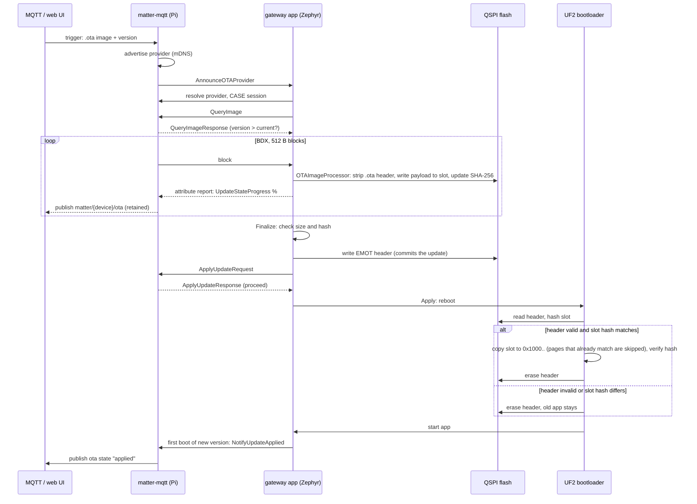

# Matter OTA over external QSPI flash: plan

Status: plan, not implemented yet. Once it works, the description moves to the wiki ([Bootloader](https://github.com/BerndDA/enocean-ble-matter-bridge/wiki/Bootloader) and a new OTA page), and this file goes away.

## Goal

Update the gateway firmware over Thread with standard Matter OTA. The provider is matter-mqtt (`spike/matter-mqtt`) on the Pi. The image goes to the external QSPI flash first. After a reboot, the EnMT UF2 bootloader (`firmware/bootloader`) copies it into internal flash and starts it.

There is no MCUboot. The UF2 bootloader stays the only bootloader. The UF2 drive, `SETTINGS.UF2`, the factory data and the settings are unchanged.

Boards: `enmt-dk` first (nRF52840 DK, MX25R6435F, 8 MB), then `enmt` (carrier v0.4, W25Q32JV, 4 MB). `promicro-uf2` has no external flash and keeps working without OTA.

## Flow



## Flash layout

Internal flash is unchanged (`firmware/enocean-gateway/boards/promicro_nrf52840_nrf52840_uf2.overlay`):

| Address | Content |
|---|---|
| 0x00000 | MBR |
| 0x01000 | app, at most 888 KB (up to 0xdf000) |
| 0xdf000 | staging for bootloader updates |
| 0xe9000 | factory data |
| 0xea000 | settings |
| 0xf4000 | UF2 bootloader |

External QSPI flash (the same offsets on both chips):

| Offset | Size | Content |
|---|---|---|
| 0x000000 | 4 KB | OTA header (one erase sector) |
| 0x001000 | 888 KB | image slot: raw app binary for 0x1000 |
| rest | | free (later: previous image for rollback) |

### OTA header

The header is little endian and fits in one 4 KB sector:

| Field | Type | Meaning |
|---|---|---|
| `magic` | u32 | `"EMOT"` |
| `header_version` | u32 | 1 |
| `load_addr` | u32 | must be 0x1000 |
| `size` | u32 | image bytes, ≤ 0xde000 |
| `sw_version` | u32 | Matter software version of the image (for logging) |
| `sha256` | u8[32] | over the `size` bytes in the slot |

The app writes the header only after the whole slot has been written and its hash checked. That write is what "commits" the update. A partly downloaded image never has a header.

The bootloader consumes the header: it erases it once internal flash has been verified against it (one 4 KB sector erase, a few register writes). It also erases a header that is invalid or whose slot hash doesn't match, so a bad image is tried only once and the old app keeps running.

- If power is lost during the copy, the header is still there and the next boot copies again. Pages that already hold the right data are skipped, so the repeat is shorter.
- The header is handled before the UF2 drive starts, so a `.uf2` flashed afterwards is never overwritten by an older staged image.
- If the new app is broken, the UF2 drive is still available.
- The app never has to erase the header after an update. It only erases it in `PrepareDownload` / `Abort`, so a half-written slot never sits behind an old header.

## Phase 1: bootloader (`firmware/bootloader`): done

Implemented and bench-tested on the DK (2026-11-26):

- `enmt_ota.c` / `enmt_ota.h`: hardware-independent apply logic.
- `enmt_qspi_ota.c`: register-level QSPI (READ2O, 8 MHz, sector erase, release from deep power-down) and NVMC.
- The hook in `main()` lives in `boards.patch`.
- Bootloader size: +768 B. 33.2 KB of 38 KB used.
- Host test: `test/ota_test.c` in `./test.sh`.
- `ota-stage.py`: builds a QSPI hex (header and slot) from a `zephyr.bin` for `nrfjprog --qspisectorerase`.

Bench results on the DK:

| Test | Result |
|---|---|
| Empty internal flash, 820 KB image staged | copied, byte-identical, header erased, app runs |
| App replaced by an 876 KB image | app back on USB 31.8 s after reset; most of that is NVMC page erase and write (about 0.13 s per page) |
| Corrupt image (one byte flipped) | refused after hashing (2.4 s), header erased, old app unchanged |
| Pin reset 12 s into the copy | next boot finished in 19.9 s (copied pages skipped), byte-identical |
| UF2 drive (GPREGRET 0x57) | unchanged |

Not done yet: the carrier (`enmt`) is built but untested, since v0.4 isn't ordered.

The original Phase 1 plan:

1. `board.mk` / `board.h` for `enmt_dk` and `enmt`:
   - `-DBOARD_QSPI_OTA`
   - QSPI pins:
     - DK: CSN P0.17, SCK P0.19, IO0..3 P0.20..P0.23
     - carrier: SCK P0.17, CSN P0.24, IO0 P0.22, IO1 P0.20, IO2 P1.00, IO3 P0.11
2. New `enmt_qspi_ota.c`, called early in `main()` before USB starts, and not when the DFU button is held or DFU was requested (GPREGRET):
   - QSPI activate, read the header (`READ` register task, or nrfx_qspi if it fits).
   - Check magic, version, `load_addr`, and `size` ≤ 0xde000.
   - Hash the QSPI slot (tinycrypt `sha256.c`, already linked). On a mismatch, do nothing.
   - Hash internal flash. On a match, skip the copy.
   - Copy: per 4 KB page, NVMC erase, then read QSPI into a 4 KB RAM buffer and write it. Hash internal flash again.
   - LED pattern during the copy (`enmt_leds.h`): a new "updating" state.
   - Deactivate and uninit QSPI, set the pins back to default (nRF52840 erratum 122, and Zephyr's QSPI driver expects the peripheral in its reset state).
3. Size budget: about 5.7 KB is free in the 38 KB region. If it doesn't fit, use direct register access instead of nrfx_qspi.
4. Host test (`test/`, like `settings_test`): header parsing, range checks, the skip logic against a fake flash.
5. Bench test before any Matter work: write a header and a test app to QSPI with `nrfjprog --qspi*` (DK) or a small Zephyr shell command. Reset, check the app starts, and check the factory data and settings are unchanged. Cut power during the copy and check that the next boot finishes it.

## Phase 2: firmware (`firmware/common`, both gateway apps)

1. Devicetree:
   - `enmt_dk.overlay` and `enmt_carrier.overlay`: a `&qspi` node with the flash chip (`nordic,qspi-nor`: MX25R64 or W25Q32JV, quad mode, pins as above).
   - An `ota_header` partition and an `ota_slot` partition on it.
2. Kconfig:
   - `CONFIG_CHIP_OTA_REQUESTOR=y` for `enmt` / `enmt-dk` only.
   - Not NCS's MCUboot/DFU-target image processor. `Kconfig.sysbuild` currently ties `MATTER_OTA` to MCUboot. To check: which options turn on the requestor without `dfu_target`/`DFU_MULTI_IMAGE`.
3. A custom `OTAImageProcessorImpl` (`chip::OTAImageProcessorInterface`) in `firmware/common/ota/`:
   - `PrepareDownload`: erase the header first, then the slot (or erase sectors as data arrives), start SHA-256.
   - `ProcessBlock`: the first bytes go through `chip::OTAImageHeaderParser`, the payload goes to the slot via `flash_area_write`.
   - `Finalize`: check the payload size and the hash in the `.ota` header (`ImageDigest`), then write the EMOT header.
   - `Apply`: `sys_reboot` (only after the header is written).
   - `Abort`: erase the header, leave the slot alone.
   - `IsFirstImageRun` / `ConfirmCurrentImage`: compare the running version with the target version kept in settings. On a match, report applied. The bootloader has already erased the header.
4. Wire it to the requestor: `DefaultOTARequestor`, `DefaultOTARequestorDriver`, `DefaultOTARequestorStorage`, `BDXDownloader`. NCS's `ota_util.cpp` is the template.
   - Add the OTA Software Update Requestor cluster (0x002A) on endpoint 0 to both `bridge.zap` / `bridge.matter`; it isn't there today. Its `UpdateState` (0x0002) and `UpdateStateProgress` (0x0003, 0–100 %) are what matter-mqtt shows as download progress (Phase 5). `DefaultOTARequestor` updates both on its own.
5. Software version: `CONFIG_CHIP_DEVICE_SOFTWARE_VERSION` / `_STRING` must come from `VERSION`. Every release must raise the version number, or the requestor ignores the offer. To check how NCS derives it.
6. Show the OTA state on the status page (`common/web`) and in the netlog.

## Phase 3: build (`Makefile`)

- For `BOARD=enmt` / `enmt-dk`, also build `<app>-<version>.ota`: `zephyr.bin` wrapped with connectedhomeip's `src/app/ota_image_tool.py create`.
  - `-v` vendor ID and `-p` product ID: match the device (`CONFIG_CHIP_DEVICE_PRODUCT_ID=32771`).
  - `-vn` version number, `-vs` version string.
  - `-da sha256`.
- `make-uf2.py`'s range checks also apply to the `.ota` payload (≤ 888 KB from 0x1000).

## Phase 4: manual end-to-end test

1. Commission the `enmt-dk` gateway into the matter-mqtt fabric.
2. Stop matter-mqtt: only one process may use the fabric.
3. Run the crate example against the same store:
   `cargo run --example serve_ota -- --store state/controller.bin --node <id> --version <n> --image <app>.ota --block-size 512`
   (from the matter-controller 0.18.3 crate, `ota` feature).
4. Expected: the download over Thread takes several minutes; then reboot, bootloader copy, new version running, `NotifyUpdateApplied`, and the example exits.
5. Failure cases:
   - power off during the download (no header, old app keeps running)
   - power off during the copy (copy repeats)
   - the same version offered again (rejected)
   - a corrupt `.ota` (hash check fails in `Finalize`)

## Phase 5: matter-mqtt (`spike/matter-mqtt`)

1. `Cargo.toml`: `matter-controller = { version = "0.18.3", default-features = false, features = ["ota"] }`.
2. Trigger. The binary never goes through the broker, because `mqtt.rs` caps packets at 256 KB:
   - MQTT: `matter/<device>/ota/set` with `{"url": "...", "version": 7}`. matter-mqtt downloads the `.ota` (or reads a path under `/data/ota`).
   - Web: `POST /api/nodes/{id}/ota` (multipart upload plus version) and a button in `index.html`.
3. A tokio task per update. Only one update at a time across all devices. `serve_ota_with_block_size(node, image, version, port, 512)` inside `tokio::time::timeout` (about 30 min).
4. Progress, retained, on `matter/<device>/ota`:
   ```json
   {"state": "announcing", "progress": 42, "from": 6, "to": 7, "error": null, "since": 1764150000}
   ```
   - `state` comes from two sources:
     - matter-mqtt's own task: `announcing`, `failed` (timeout, BDX abort, version rejected), `applied` (once `serve_ota` returns).
     - the device's requestor attributes, which matter-mqtt already receives through its subscription to every attribute: `UpdateState` (0x002A/0x0002) gives `querying`, `downloading`, `applying`, `rebooting`, and `UpdateStateProgress` (0x002A/0x0003) gives `progress` in %.
   - matter-controller's `serve_ota` has no progress callback, so the progress comes from the device rather than from the BDX sender. No crate patch is needed. If the device's progress turns out to be too coarse, the fallback is a `[patch.crates-io]` fork of the crate with a callback at the block counter in `ProviderServer::serve_ota_once`.
   - While the device reboots it goes offline, and its subscription drops and comes back. Keep `state` at `rebooting` until the Basic Information `SoftwareVersion` shows `to`.
   - Clear the retained message (or set `idle`) a while after `applied` / `failed`, so the UI doesn't show stale bars forever.
   - Also map `UpdateState` / `UpdateStateProgress` in `mapping.rs`, so every device's OTA state shows up even for updates started elsewhere.
5. Docker: host networking (already required) also covers the provider's mDNS advertisement. Pick a fixed provider port (e.g. 5560) in case of firewalls.
6. Web UI progress over MQTT:
   - `index.html` subscribes to `matter/+/ota` with mqtt.js (from cdnjs/jsdelivr, a pinned version) over WebSockets, and shows a progress bar and state per device row.
   - The broker on the Pi already has a read-only, anonymous WebSocket listener: port 9001, `wss://mqtt.home.seidenspinner.tv` through traefik. Check that its ACL (`acl_websockets`, root-only on the Pi) allows reading `matter/#`.
   - New flag `--mqtt-ws <url>` (env `MQTT_WS`). The page gets it from a small `GET /api/config`. Without it, the page hides the progress view and keeps working as today.
   - The browser only reads. Starting an update stays a REST call (`POST /api/nodes/{id}/ota`), so the read-only listener is enough and needs no credentials in the page.
   - Because the status is retained, a page opened mid-update shows the current state immediately.

## Security

Anyone who can publish to `matter/+/ota/set` or reach the web UI can install firmware. The library sends the image unsigned, and SHA-256 only catches corruption.

- v1: a mosquitto ACL so only matter-mqtt's own user and an admin user may write `matter/+/ota/set`. The web UI is reachable from localhost only (the default).
- Later: an Ed25519 signature over the image, with the public key in the bootloader, which checks it before copying. This needs a small Ed25519 verify implementation, since tinycrypt has none. Check that it fits the size budget.

## Out of scope for v1

- Rollback if the new app boots but hangs. Later: keep the previous image in the free QSPI space, have the app set a "confirmed" flag, and count boots in GPREGRET2.
- Bootloader updates over OTA. They stay `BOOTLOAD.UF2` / `update-*.uf2` over USB.
- `promicro-uf2` and `dk` builds (no QSPI or a different layout).

## Open questions

- Which NCS Kconfig options give the OTA requestor without MCUboot/`dfu_target`? (Phase 2.2)
- How NCS derives the Matter software version from `VERSION`. (Phase 2.5)
- Is the vendor ID still the test VID 0xFFF1? It must match in the `.ota`.
- Is BDX over Thread through the OTBR reliable at 512 B blocks, and how long does 888 KB take?
