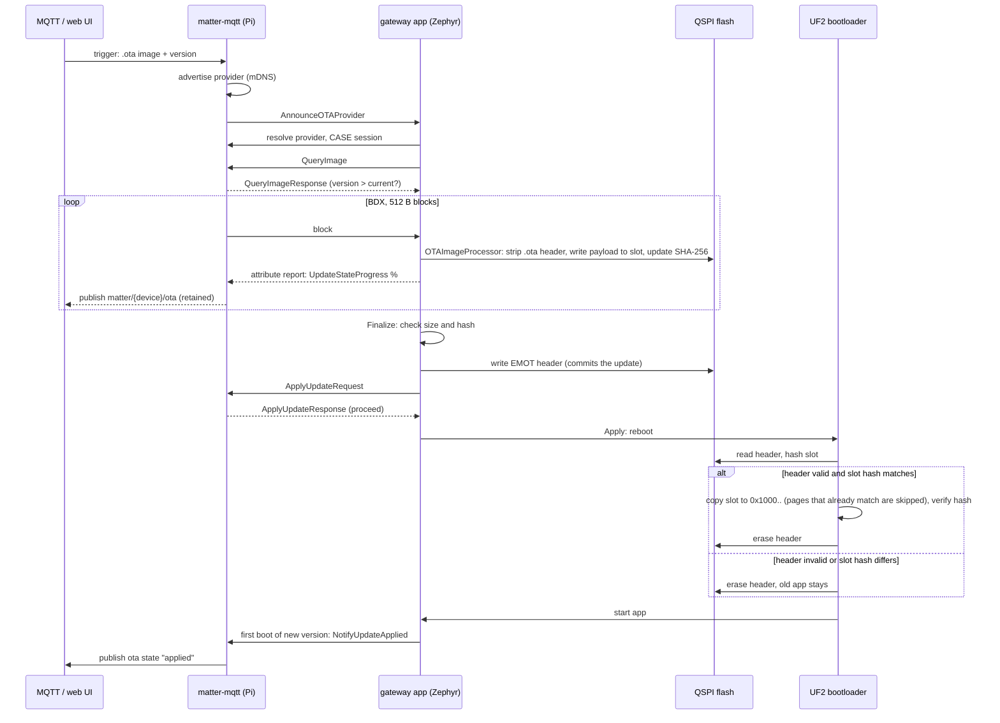

# Matter OTA over external QSPI flash: plan

Status: plan, not implemented yet. Once it works, the description moves to the wiki ([Bootloader](https://github.com/BerndDA/enocean-ble-matter-bridge/wiki/Bootloader) and a new OTA page), and this file goes away.

## Goal

Update the gateway firmware over Thread with standard Matter OTA. The provider is matter-mqtt (`spike/matter-mqtt`) on the Pi. The image goes to the external QSPI flash first. After a reboot, the EnMT UF2 bootloader (`firmware/bootloader`) copies it into internal flash and starts it.

There is no MCUboot. The UF2 bootloader stays the only bootloader. The UF2 drive, `SETTINGS.UF2`, the factory data and the settings are unchanged.

Boards: `enmt-dk` first (nRF52840 DK, MX25R6435F, 8 MB), then `enmt` (carrier v0.4, W25Q32JV, 4 MB). `promicro-uf2` has no external flash and keeps working without OTA.

## Flow



## Flash layout

Internal flash is unchanged (`firmware/enocean-gateway/boards/promicro_nrf52840_nrf52840_uf2.overlay`):

| Address | Content |
|---|---|
| 0x00000 | MBR |
| 0x01000 | app, at most 888 KB (up to 0xdf000) |
| 0xdf000 | staging for bootloader updates |
| 0xe9000 | factory data |
| 0xea000 | settings |
| 0xf4000 | UF2 bootloader |

External QSPI flash (the same offsets on both chips):

| Offset | Size | Content |
|---|---|---|
| 0x000000 | 4 KB | OTA header (one erase sector) |
| 0x001000 | 888 KB | image slot: raw app binary for 0x1000 |
| rest | | free (later: previous image for rollback) |

### OTA header

The header is little endian and fits in one 4 KB sector:

| Field | Type | Meaning |
|---|---|---|
| `magic` | u32 | `"EMOT"` |
| `header_version` | u32 | 1 |
| `load_addr` | u32 | must be 0x1000 |
| `size` | u32 | image bytes, ≤ 0xde000 |
| `sw_version` | u32 | Matter software version of the image (for logging) |
| `sha256` | u8[32] | over the `size` bytes in the slot |

The app writes the header only after the whole slot has been written and its hash checked. That write is what "commits" the update. A partly downloaded image never has a header.

The bootloader consumes the header: it erases it once internal flash has been verified against it (one 4 KB sector erase, a few register writes). It also erases a header that is invalid or whose slot hash doesn't match, so a bad image is tried only once and the old app keeps running.

- If power is lost during the copy, the header is still there and the next boot copies again. Pages that already hold the right data are skipped, so the repeat is shorter.
- The header is handled before the UF2 drive starts, so a `.uf2` flashed afterwards is never overwritten by an older staged image.
- If the new app is broken, the UF2 drive is still available.
- The app never has to erase the header after an update. It only erases it in `PrepareDownload` / `Abort`, so a half-written slot never sits behind an old header.

## Phase 1: bootloader (`firmware/bootloader`): done

Implemented and bench-tested on the DK (2026-11-26):

- `enmt_ota.c` / `enmt_ota.h`: hardware-independent apply logic.
- `enmt_qspi_ota.c`: register-level QSPI (READ2O, 8 MHz, sector erase, release from deep power-down) and NVMC.
- The hook in `main()` lives in `boards.patch`.
- Bootloader size: +768 B. 33.2 KB of 38 KB used.
- Host test: `test/ota_test.c` in `./test.sh`.
- `ota-stage.py`: builds a QSPI hex (header and slot) from a `zephyr.bin` for `nrfjprog --qspisectorerase`.

Bench results on the DK:

| Test | Result |
|---|---|
| Empty internal flash, 820 KB image staged | copied, byte-identical, header erased, app runs |
| App replaced by an 876 KB image | app back on USB 31.8 s after reset; most of that is NVMC page erase and write (about 0.13 s per page) |
| Corrupt image (one byte flipped) | refused after hashing (2.4 s), header erased, old app unchanged |
| Pin reset 12 s into the copy | next boot finished in 19.9 s (copied pages skipped), byte-identical |
| UF2 drive (GPREGRET 0x57) | unchanged |

Not done yet: the carrier (`enmt`) is built but untested, since v0.4 isn't ordered.

The original Phase 1 plan:

1. `board.mk` / `board.h` for `enmt_dk` and `enmt`:
   - `-DBOARD_QSPI_OTA`
   - QSPI pins:
     - DK: CSN P0.17, SCK P0.19, IO0..3 P0.20..P0.23
     - carrier: SCK P0.17, CSN P0.24, IO0 P0.22, IO1 P0.20, IO2 P1.00, IO3 P0.11
2. New `enmt_qspi_ota.c`, called early in `main()` before USB starts, and not when the DFU button is held or DFU was requested (GPREGRET):
   - QSPI activate, read the header (`READ` register task, or nrfx_qspi if it fits).
   - Check magic, version, `load_addr`, and `size` ≤ 0xde000.
   - Hash the QSPI slot (tinycrypt `sha256.c`, already linked). On a mismatch, do nothing.
   - Hash internal flash. On a match, skip the copy.
   - Copy: per 4 KB page, NVMC erase, then read QSPI into a 4 KB RAM buffer and write it. Hash internal flash again.
   - LED pattern during the copy (`enmt_leds.h`): a new "updating" state.
   - Deactivate and uninit QSPI, set the pins back to default (nRF52840 erratum 122, and Zephyr's QSPI driver expects the peripheral in its reset state).
3. Size budget: about 5.7 KB is free in the 38 KB region. If it doesn't fit, use direct register access instead of nrfx_qspi.
4. Host test (`test/`, like `settings_test`): header parsing, range checks, the skip logic against a fake flash.
5. Bench test before any Matter work: write a header and a test app to QSPI with `nrfjprog --qspi*` (DK) or a small Zephyr shell command. Reset, check the app starts, and check the factory data and settings are unchanged. Cut power during the copy and check that the next boot finishes it.

## Phase 2: firmware (`firmware/common`): done, tested end to end (Phase 4)

Done (2026-11-26):

- **Devicetree:** `common/boards/enmt_dk.overlay` and `enmt_carrier.overlay` add the QSPI flash with `ota_header_partition` (0x0, 4 KB) and `ota_slot_partition` (0x1000, 888 KB).
  - DK: MX25R6435F, the node from Zephyr's nrf52840dk board files.
  - Carrier: W25Q32JV with `quad-enable-requirements = "NONE"` (QE fixed at 1 on the IQ part). Untested.
- **No `CHIP_OTA_REQUESTOR`.** In NCS that option pulls in MCUboot, `dfu_target`, `DFU_MULTI_IMAGE` and NCS's `ota_util.cpp`. Instead:
  - New `CONFIG_GATEWAY_OTA` (`common/Kconfig`). It's on by default when the devicetree has `ota_slot_partition` and requires `CHIP_OTA_REQUESTOR` to be off.
  - The requestor's own code (`DefaultOTARequestor`, `BDXDownloader`, the cluster server) comes from the data model: the OTA Software Update Requestor cluster (0x002A) is already in all three `bridge.zap` files.
  - Side effect: the Matter shell's `matter ota …` commands answer `Error: 2f`, since they are compiled only with `CHIP_OTA_REQUESTOR`.
- **`common/ota/gateway_ota.cpp`:**
  - `Gateway::Ota::Init()` is called in each `app_task.cpp` before `StartServer()`. It sets the requestor up on `kServerReady`, as NCS does. On Thread, Matter posts that only once DNS-SD is up, i.e. after commissioning.
  - Image processor:
    - `PrepareDownload` erases the header.
    - Blocks go to the slot in 1 KB writes, each 4 KB sector erased on first use, with a running SHA-256.
    - The `.ota` header's vendor and product must match the factory data, and the payload must have a SHA-256 digest and fit the app area.
    - `Finalize` compares the hash, then writes the EMOT header.
    - `Apply` reboots only if a valid header is there.
    - `Abort` erases the header.
  - The header layout and `enmt_ota_header_ok()` come straight from `firmware/bootloader/enmt_ota.h`.
- **Software version:** with a `VERSION` file NCS uses `APPVERSION` = major<<24 | minor<<16 | patch<<8 | tweak. So 0.1.0 is 0x00010000 and `VERSION_TWEAK = 1` gives 0x00010001. The vendor is still the test VID 0xFFF1, PID 0x8003 (enocean-gateway).
- **Size:** enocean-gateway `enmt-dk` grows from 767 KB to 800 KB (+33 KB: QSPI driver, requestor, BDX). RAM use is 84.6 %.
- **ble-gateway: no OTA for now.** With OTA it overflowed the 888 KB app area by 492 bytes. Its UF2 board config sets `CONFIG_GATEWAY_OTA=n`, which brings it to 881 KB. That's 4.6 KB more than before, because the QSPI driver stays: the flash map needs it for the overlay's partitions.

Still open in Phase 2:

- Later: room for OTA in ble-gateway. Stage bootloader updates in the QSPI flash instead of 0xDF000–0xE9000, so the app area grows to about 928 KB on boards with QSPI. This touches the bootloader's staging code, the UF2 overlay's layout and `make-uf2.py`'s checks, and gives boards with and without QSPI different layouts.
- Show the OTA state on the status page (`common/web`) and in the netlog.

## Phase 3: build: done in Phase 2

`common.cmake` builds `zephyr/matter.ota` with NCS's `chip_ota_image()` (connectedhomeip's `ota_image_tool.py`):
- vendor and product from Kconfig;
- version and string from `VERSION`;
- SHA-256 digest;
- payload `zephyr.bin`.

Still to do: copy it next to the `.uf2` under a name with the version, from the Makefile.

## Phase 4: manual end-to-end test: passed (2026-11-26)

**Setup:**
- The DK runs enocean-gateway `enmt-dk` 0.1.0 (0x10000) with the new bootloader.
- It is commissioned in Apple Home and, via a pairing code, into a separate test fabric: a local matter-mqtt with its own state file and `--mqtt none`.
- matter-mqtt was then stopped, and the crate's `serve_ota` example run on the Mac against that state file:
  `serve_ota --store controller.bin --node 2 --version 65537 --image matter.ota --port 5560 --block-size 512`
- The image is a build with `VERSION_TWEAK = 1` (0x10001).

**Result:**

| Step | Time |
|---|---|
| AnnounceOTAProvider → first QueryImage over the announce session times out (by design, see the crate's `serve_ota` docs) | 51 s |
| Retry: new CASE to the provider on port 5560, QueryImageResponse 65537 | |
| BDX download, 1564 × 512 B (about 10 blocks/s, 5 KB/s over Thread) | 156 s |
| `OTA: version 65537 staged` → ApplyUpdate → reboot | |
| Bootloader copy, app up, NotifyUpdateApplied, `serve_ota` exits 0 | 7 s |

- Internal flash matches the new `zephyr.bin`, and the QSPI header was erased.
- The copy took only 7 s because the two builds differ in 3 of 196 pages and the bootloader skips pages that already match. A real release with more changes takes up to about 30 s.

**Pitfall:** the gateway reuses *any* existing session to the provider's node ID. In the first attempt it still had a session from the stopped matter-mqtt process, which had been killed without a CloseSession. So the retry went there, and the requestor gave up after its single retry. Resetting the gateway fixed it. For Phase 5 this means the provider runs in the same process as the controller (matter-mqtt itself), so there are no stale sessions from a second process.

## Phase 5: matter-mqtt (`spike/matter-mqtt`)

1. `Cargo.toml`: `matter-controller = { version = "0.18.3", default-features = false, features = ["ota"] }`.
2. Trigger. The binary never goes through the broker, because `mqtt.rs` caps packets at 256 KB:
   - MQTT: `matter/<device>/ota/set` with `{"url": "...", "version": 7}`. matter-mqtt downloads the `.ota` (or reads a path under `/data/ota`).
   - Web: `POST /api/nodes/{id}/ota` (multipart upload plus version) and a button in `index.html`.
3. A tokio task per update. Only one update at a time across all devices. `serve_ota_with_block_size(node, image, version, port, 512)` inside `tokio::time::timeout` (about 30 min).
4. Progress, retained, on `matter/<device>/ota`:
   ```json
   {"state": "announcing", "progress": 42, "from": 6, "to": 7, "error": null, "since": 1764150000}
   ```
   - `state` comes from two sources:
     - matter-mqtt's own task: `announcing`, `failed` (timeout, BDX abort, version rejected), `applied` (once `serve_ota` returns).
     - the device's requestor attributes, which matter-mqtt already receives through its subscription to every attribute: `UpdateState` (0x002A/0x0002) gives `querying`, `downloading`, `applying`, `rebooting`, and `UpdateStateProgress` (0x002A/0x0003) gives `progress` in %.
   - matter-controller's `serve_ota` has no progress callback, so the progress comes from the device rather than from the BDX sender. No crate patch is needed. If the device's progress turns out to be too coarse, the fallback is a `[patch.crates-io]` fork of the crate with a callback at the block counter in `ProviderServer::serve_ota_once`.
   - While the device reboots it goes offline, and its subscription drops and comes back. Keep `state` at `rebooting` until the Basic Information `SoftwareVersion` shows `to`.
   - Clear the retained message (or set `idle`) a while after `applied` / `failed`, so the UI doesn't show stale bars forever.
   - Also map `UpdateState` / `UpdateStateProgress` in `mapping.rs`, so every device's OTA state shows up even for updates started elsewhere.
5. Docker: host networking (already required) also covers the provider's mDNS advertisement. Pick a fixed provider port (e.g. 5560) in case of firewalls.
6. Web UI progress over MQTT:
   - `index.html` subscribes to `matter/+/ota` with mqtt.js (from cdnjs/jsdelivr, a pinned version) over WebSockets, and shows a progress bar and state per device row.
   - The broker on the Pi already has a read-only, anonymous WebSocket listener: port 9001, `wss://mqtt.home.seidenspinner.tv` through traefik. Check that its ACL (`acl_websockets`, root-only on the Pi) allows reading `matter/#`.
   - New flag `--mqtt-ws <url>` (env `MQTT_WS`). The page gets it from a small `GET /api/config`. Without it, the page hides the progress view and keeps working as today.
   - The browser only reads. Starting an update stays a REST call (`POST /api/nodes/{id}/ota`), so the read-only listener is enough and needs no credentials in the page.
   - Because the status is retained, a page opened mid-update shows the current state immediately.

## Security

Anyone who can publish to `matter/+/ota/set` or reach the web UI can install firmware. The library sends the image unsigned, and SHA-256 only catches corruption.

- v1: a mosquitto ACL so only matter-mqtt's own user and an admin user may write `matter/+/ota/set`. The web UI is reachable from localhost only (the default).
- Later: an Ed25519 signature over the image, with the public key in the bootloader, which checks it before copying. This needs a small Ed25519 verify implementation, since tinycrypt has none. Check that it fits the size budget.

## Out of scope for v1

- Rollback if the new app boots but hangs. Later: keep the previous image in the free QSPI space, have the app set a "confirmed" flag, and count boots in GPREGRET2.
- Bootloader updates over OTA. They stay `BOOTLOAD.UF2` / `update-*.uf2` over USB.
- `promicro-uf2` and `dk` builds (no QSPI or a different layout).

## Open questions

None at the moment.

Answered in Phases 2 and 4:
- BDX over Thread at 512 B blocks: reliable in the test, about 5 KB/s, so roughly 3 minutes for 888 KB.
- Requestor without MCUboot: no `CHIP_OTA_REQUESTOR`; our own `GATEWAY_OTA` with the data model's requestor code.
- Software version: from `VERSION` via `APPVERSION`.
- Vendor ID: still the test VID 0xFFF1, and the `.ota` takes it from Kconfig.
- ble-gateway with OTA: doesn't fit (492 bytes over). OTA is off there for now; more room is a later step (Phase 2, "Still open").
