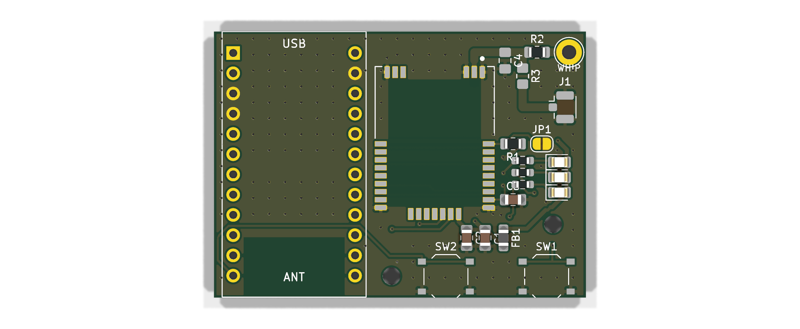
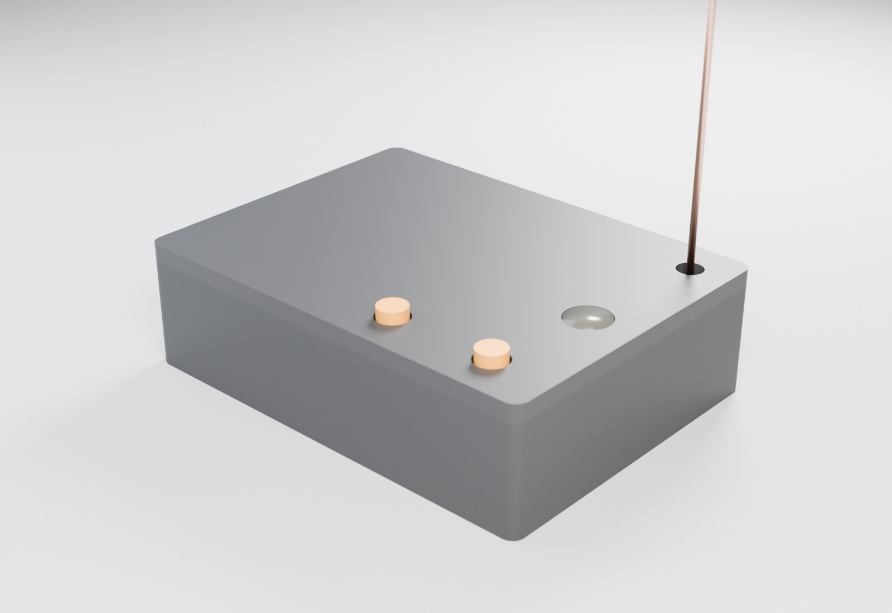
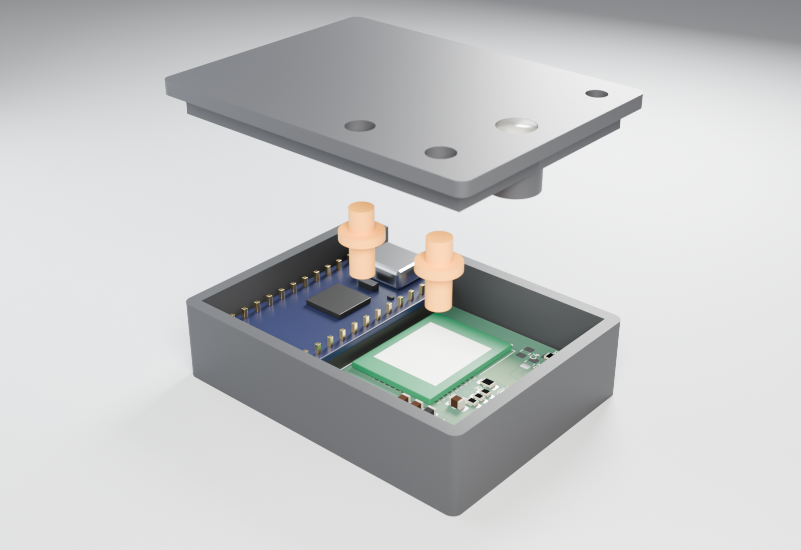
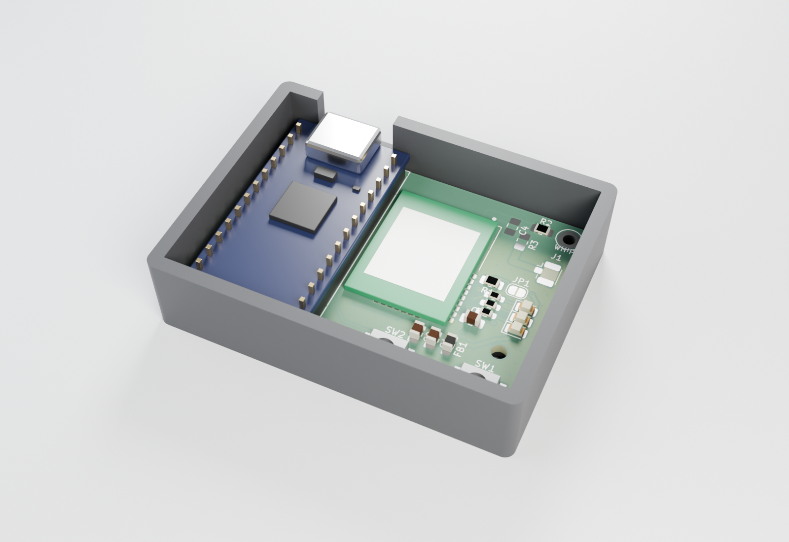

# EnOcean carrier board

A Pro Micro nRF52840 (nice!nano / SuperMini) soldered onto a small 2-layer board that carries a TCM 515. It replaces the Pro Micro + EnOcean Pi hat with four wires, and is the simpler alternative to the [full custom board](../enocean-bridge-pcb/DESIGN.md).

**The Pro Micro build of [firmware/enocean-gateway](../../firmware/enocean-gateway/) runs unchanged** (`BOARD=promicro-uf2`): the carrier uses exactly the pins that build expects.



Status: **v0.2** (three status LEDs red/green/yellow, whip hole for 1.5 mm wire): schematic and board done, fabrication files exported ([fab/](fab/)). v0.1 is the git tag `enocean-carrier-v0.1`. ERC clean, DRC 0 errors and 0 unconnected, only silkscreen warnings. Nothing is ordered yet; open items are in the repo's [TODO.md](../../TODO.md).

## Why a carrier

The Pro Micro brings the hard parts: the nRF52840 with its RF match and 2.4 GHz antenna, USB, the 3.3 V regulator and the UF2 bootloader. The carrier only needs the TCM 515 and a handful of 0805 parts. That means 2 layers, no fine pitch, no via in pad and no PCB assembly: everything can be hand-soldered.

Compared with the custom board: about €20–25 per board instead of €40–55, a few dollars for the PCBs, but bigger (46.5 × 33.4 mm, with the module 2.5 mm above the carrier on its pin headers).

## Pin map

| Function | Pro Micro pin (from the USB end) | nRF52840 | Connects to |
| --- | --- | --- | --- |
| 3.3 V | right 4 (VCC) | regulator output | FB1 → TCM VDD |
| GND | left 3, left 4, right 2 | — | GND pours |
| Reset | right 3 (RST) | P0.18 | SW1 (small SMD button) to GND: press = reset, double-tap = UF2 bootloader |
| UART TX → TCM | right 12 | P0.09 | TCM 515 pin 20 UART_RX |
| UART RX ← TCM | right 11 | P0.10 | TCM 515 pin 21 UART_TX |
| Function button | left 12 | P1.06 | SW2 to GND: hold 6 s for a factory reset |
| Status LEDs | right 10 / 9 / 8 | P1.11 red, P1.13 green, P1.15 yellow | 3.3 V → LED D1 / D2 / D3 → R4 1 kΩ / R5 330 Ω / R6 1 kΩ → pin; **active low**. Unused by today's firmware (pins float, LEDs dark) |
| TCM reset | left 6 | P0.20 | TCM 515 pin 24 nRESET (unused by today's firmware; the TCM's pull-up wins) |

The full header order, from [TinyGo's nice!nano pin list](https://tinygo.org/docs/reference/microcontrollers/boards/nicenano/), matches the classic Pro Micro layout. **Before soldering, check it against your module's silkscreen**: B+, GND, RST and VCC must be the top four pins of the right column with the USB end up and the components facing up. Square pad = pin 1 = P0.06.

On a nice!nano, VCC is switched off while P0.13 is high. The firmware doesn't drive P0.13, and the TCM on VCC works today with the Pi hat.

## Circuit

The circuit follows the TCM 515 User Manual v1.22; details and sources are in the custom board's [DESIGN.md](../enocean-bridge-pcb/DESIGN.md#tcm-515-user-manual-v122).

- **TCM VDD:** ferrite bead FB1 (600 Ω at 100 MHz) from the Pro Micro's 3.3 V, then C1 22 µF + C2 100 nF at the pin.
- **TCM nRESET:** C3 100 nF to GND at the pin, plus a link to P0.20.
- **nTURBO:** R1 10 kΩ pull-up (57600 baud at power-up). JP1 is an open solder jumper to GND that would select 460800 baud; leave it open.
- **868 MHz:** RF_50 → node.
  - R2 0 Ω up to the whip hole (86 mm wire, as certified). The hole takes wire up to 1.5 mm (1.8 mm drill, 3.2 mm pad), e.g. 1.5 mm² solid copper.
  - R3 0 Ω (not fitted) to the u.FL J1 (not fitted), as the alternative.
  - C4 shunt pad (not fitted) for tuning.
  - The line is 1.0 mm wide with a 0.2 mm gap to the pour (~54 Ω on 1.6 mm FR4; 1.2 mm would be 50 Ω), necked to 0.6 mm along the TCM pad.
- **Two buttons**, SMD tactile switches XKB TS-1187A (5.1 × 5.1 mm; LCSC C318884, the only tactile switch in JLC's basic library): SW1 on the Pro Micro's RST, SW2 on P1.06 (function button).
- **Status LEDs:** three single 0805 LEDs in a column under one light pipe, all from JLC's basic library: D1 red (NationStar NCD0805R1, C84256), D2 green (KT-0805G, C2297), D3 yellow (KT-0805Y, C2296). No blue LED is in the basic library, so yellow takes its place, and JLC places them without an extended-part fee. Anodes on 3.3 V, each cathode through its resistor to a Pro Micro pin: red R4 1 kΩ on P1.11, green R5 330 Ω on P1.13, yellow R6 1 kΩ on P1.15. A pin pulled low lights its LED, about 1.3 mA each for red and yellow, about 2 mA for the (much brighter) green. The TCM 515 has no LED output, so the firmware drives them (e.g. colour per state, blink per telegram); until it does, the pins float and the LEDs stay dark. The first v0.2 had a 3528 RGB LED here (commit 2b49487).
- **No test pads.** The TCM's UART can be probed at the Pro Micro pins. TCM TP1–TP3 stay unconnected (EnOcean recommends pads there for their own debugging).

## Board

[enocean-carrier.kicad_pcb](enocean-carrier.kicad_pcb): 46.5 × 33.4 mm, 2 layers, 1.6 mm, GND pours on both sides.

- **The Pro Micro** sits on the left: USB end flush with the top edge, antenna end flush with the bottom edge. Its footprint ([../lib/Modules.pretty](../lib/Modules.pretty)) keeps all copper out from between the header rows under the antenna.
- **The TCM 515** stands upright next to it (rotated 270°). VDD and UART are at its bottom edge, a few millimetres from the Pro Micro's P0.09/P0.10. RF_50 is at its top edge, facing the whip pad in the top-right corner and the u.FL at the right edge below it (so a pigtail leaves the board directly), as far as possible from the 2.4 GHz antenna. No top copper under the module (keepout in its footprint).
- **The parts around it:** C2, C1 and FB1 in a row below the TCM at VDD; R1/JP1 (nTURBO), the three LEDs in a column with R4–R6 to their left, and C3 (nRESET) at its right edge; the two buttons side by side along the bottom edge, same orientation: FUNC (SW2) left, RESET (SW1) right.
- **Rules:** JLC 2-layer limits with margin: 0.15 mm track/clearance minimum, 0.25 mm default tracks, 0.6/0.3 mm vias.

Pictures: [top](enocean-carrier-top.png), [bottom](enocean-carrier-bottom.png), [top copper](enocean-carrier-layer-top.png), [bottom copper](enocean-carrier-layer-bottom.png), [schematic](enocean-carrier.png).

## How it's built

Same pipeline as the custom board; the tools are copies adapted to 2 layers:

- [tools/design.py](tools/design.py): parts, values and pin → net map. [tools/gen_schematic.py](tools/gen_schematic.py) writes the schematic, and [tools/check_netlist.py](tools/check_netlist.py) checks KiCad's netlist against it pin by pin.
- [tools/placement.py](tools/placement.py) and [tools/gen_pcb.py](tools/gen_pcb.py): board, footprints linked to the schematic, pours, rules, and the 868 MHz path. It refuses to overwrite a routed board without `--force`.
- [tools/route.py](tools/route.py): Freerouting (`autoroute.py`), then GND stitching (`stitch.py`), then DRC.
- [tools/sync_fields.py](tools/sync_fields.py): copies changed symbol fields (LCSC, MPN) onto the routed board without touching tracks.
- [tools/export_fab.py](tools/export_fab.py): Gerbers, drill, BOM and CPL for JLCPCB (see [Ordering](#ordering-at-jlcpcb)).

```sh
cd hardware/enocean-carrier
KPY=/Applications/KiCad/KiCad.app/Contents/Frameworks/Python.framework/Versions/Current/bin/python3
python3 tools/gen_schematic.py && python3 tools/check_netlist.py
$KPY tools/gen_pcb.py --force && python3 tools/route.py
$KPY tools/sync_fields.py          # after changing only part numbers / fields
python3 tools/export_fab.py
tools/render_png.sh
```

Freerouting's result can change with small placement changes: moving C2 by 0.6 mm once left a connection open. Check DRC after every run. Once the board is edited by hand, stop using `--force`.

## Ordering at JLCPCB

`python3 tools/export_fab.py` writes [fab/](fab/):

| File | Use |
| --- | --- |
| [enocean-carrier-gerbers.zip](fab/enocean-carrier-gerbers.zip) | Gerbers + Excellon drill; upload this as the PCB |
| [enocean-carrier-bom.csv](fab/enocean-carrier-bom.csv) | BOM for PCB assembly (JLC columns: Comment, Designator, Footprint, LCSC Part #) |
| [enocean-carrier-cpl.csv](fab/enocean-carrier-cpl.csv) | Placement for PCB assembly (Designator, Mid X, Mid Y, Layer, Rotation) |

**PCB:** 2 layers, FR-4, 1.6 mm, 1 oz, green, HASL lead-free, single PCB (no panel, no edge rails or fiducials, no castellated holes). Everything else default; no impedance control or via-in-pad needed. Economic assembly only allows some colours and finishes: with other choices JLC greys "Economic" out and quotes "Standard" (~$51 instead of ~$15 for the assembly).

**Assembly (optional):** "PCB Assembly", Economic, top side.
- **JLC places 14 parts**: FB1, C1, C2, C3, R1, R2, R4, R5, R6, D1–D3 and SW1/SW2, all from JLC's basic library, so no extended-part fees. Check the LED polarity in JLC's placement preview: the cathode (pad 1) faces left, towards the resistors.
- **Not in the order:**
  - U1 (Pro Micro on headers) and U2 (TCM 515): you solder those.
  - R3, J1, C4: not fitted (u.FL option).
- **Placement check:** JLC's preview shows every part on its pads before you confirm. Check the button and the 0805 parts there; rotations should need no correction.
- **Paste on unpopulated pads:** the stencil also puts paste on the TCM 515 pads and the empty u.FL pads, so they come back tinned. That makes hand-soldering the TCM easier.

**Cost, 5 boards (2026-11-18, before shipping and VAT):**

| Item | Cost |
| --- | --- |
| PCBs, 2 layers | ~$2–5 |
| Assembly: $8.18 setup + $1.53 stencil + $0.45 placement check (all parts basic, no loading fees) | ~$10 |
| Parts placed by JLC | ~$1–2 |
| Shipping to Germany | ~$10–20 |

That's roughly $30–40 for 5 assembled carriers. Add 5 × TCM 515 (Digi-Key, ~€12.50 each), Pro Micros (their 2 × 12-pin headers usually come with them), and wire for the whip.

## Parts (per board, hand-soldered)

| Ref | Part | Note |
| --- | --- | --- |
| U1 | Pro Micro nRF52840 (nice!nano v2, SuperMini) | UF2 bootloader ≥ 0.6.1; soldered onto the carrier with its 2 × 12-pin headers (no socket) |
| U2 | EnOcean TCM 515 (868 MHz) | Digi-Key 1084-TCM515, about €12.50; MSL 4: solder within 72 h of opening |
| FB1 | Ferrite bead 0805, 600 Ω at 100 MHz | e.g. Würth 742792040 |
| C1 | 22 µF 0805 X5R/X7R ≥ 6.3 V | |
| C2, C3 | 100 nF 0805 | |
| R1 | 10 kΩ 0805 | |
| R2 | 0 Ω 0805 | whip |
| SW1, SW2 | XKB TS-1187A-B-A-B, 5.1 × 5.1 mm SMD | reset, function |
| D1 | LED red 0805 (NCD0805R1, C84256) | status |
| D2 | LED green 0805 (KT-0805G, C2297) | status |
| D3 | LED yellow 0805 (KT-0805Y, C2296) | status |
| R4, R6 | 1 kΩ 0603 | red, yellow |
| R5 | 330 Ω 0603 | green |
| — | 86 mm wire, up to 1.5 mm thick | whip antenna, into the WHIP hole |
| not fitted | R3 (0 Ω), J1 (Hirose U.FL-R-SMT-1), C4 | u.FL instead of the whip: fit R3 and J1, remove R2 |

## Cost (5 boards, rough, 2026-11-18)

| Item | Cost |
| --- | --- |
| 5 PCBs, 2 layers, 46.5 × 33.4 mm, JLCPCB | ~$2–5 + shipping ~$10–20 |
| 5 × TCM 515 | ~€63 |
| 5 × Pro Micro nRF52840 (SuperMini clones; a nice!nano costs more) | ~€25–40 |
| Passives, button, headers | ~€5–10 |

About €110–140 for five, €20–30 per board.

## Case (3D-printed)

[case/carrier_case.scad](case/carrier_case.scad) (OpenSCAD) and the ready STLs in [case/](case/), rendered by `tools/export_case.sh` (OpenSCAD: `brew install --cask openscad@snapshot`):

| Part | Print |
| --- | --- |
| [carrier_case-base.stl](case/carrier_case-base.stl) | upright, no supports |
| [carrier_case-lid.stl](case/carrier_case-lid.stl) | already turned upside down, no supports |
| [carrier_case-pin.stl](case/carrier_case-pin.stl) | 2×, collar down |

| Closed | Exploded | Open |
| --- | --- | --- |
|  |  |  |

Renders: `tools/render_case.sh` (Blender + Cycles; KiCad's 3D export of the board, the case STLs, and simple stand-ins for the Pro Micro, TCM 515, buttons and whip). Assembly clips: [case/anim.mp4](case/anim.mp4) from the buttons side (`tools/render_case.sh anim`, 8 s) and [case/anim-usb.mp4](case/anim-usb.mp4) from the USB end, where the acrylic rod drops into the light pipe, a USB-C cable goes in and the EnOcean LED blinks (`tools/render_case.sh anim-usb`, 11 s). EEVEE at 32 samples, about 2–3 minutes each; pass a sample count as the second argument (e.g. `anim-usb 16` for a quick draft).

- **Size:** 51.3 × 38.2 × 14.6 mm, for the Pro Micro soldered directly on its pin headers (`pm_mount = "direct"`, the default). For a socketed Pro Micro (female headers) set `pm_mount = "socket"`: about 23 mm tall.
- **Board mounting:** the board lies flat on the 3 mm floor. Pockets 2 mm deep under the two pin rows and the whip pad take the solder joints: trim the pin ends flush after soldering. Two M2 × 6 mm screws go from the top through the board and the floor into M2 hex nuts in traps on the underside. The USB-C notch in the end wall is open at the top, so the board goes in from above with the Pro Micro on it.
- **Lid:** held by a friction lip.
  - **Buttons:** two holes with captive push pins. Put them in from below before closing; their collar keeps them in, and the tip rests 0.3 mm above the switch.
  - **LED:** a light pipe from the lid down to 1 mm above the LED, with a 5.2 mm bore for a 5 mm clear acrylic (PMMA) rod that covers all three LEDs. Cut the rod to 8.2 mm (6.2 mm pipe + 2 mm lid; `rod_len`, OpenSCAD echoes it) and press it in from the top until it is flush. Printed holes usually come out 0.1–0.2 mm small, which makes it a press fit. If the rod sits loose, fix it with a drop of glue. Sand the rod ends matte to spread the light into an even dot. An opaque, dark lid gives the best contrast.
  - **Whip:** a 3.0 mm hole above the whip pad, so the 86 mm wire (up to 1.5 mm) stands straight up through the lid.
- **u.FL variant:** `sma_hole = true` adds a 6.5 mm hole in the side wall for an SMA bulkhead with a u.FL pigtail.
- **Material:** plastic only near the antennas; no metal parts or metallic filament.

**Before printing, measure your stack:** the height of the Pro Micro above the carrier (`pm_gap`) and of its USB-C (`usb_z`) are estimates. Adjust them, run `tools/export_case.sh`, and check that the USB opening lines up. A quick test print of the base alone shows it.

## Assembly and bring-up

1. Solder the TCM 515 first (castellated pads, iron or hot air), then the 0805 parts and the buttons if JLC didn't. Leave JP1 open.
2. Solder an 86 mm wire into the WHIP hole, standing upright if possible.
3. Solder the Pro Micro on with its pin headers (short ends into the carrier, plastic spacer between the boards): USB end at the board edge, components up, square pad = pin 1. Flash it before soldering if you like; it works either way.
4. `make flash APP=enocean-gateway BOARD=promicro-uf2`; `enocean info` must show the TCM version and base ID.
